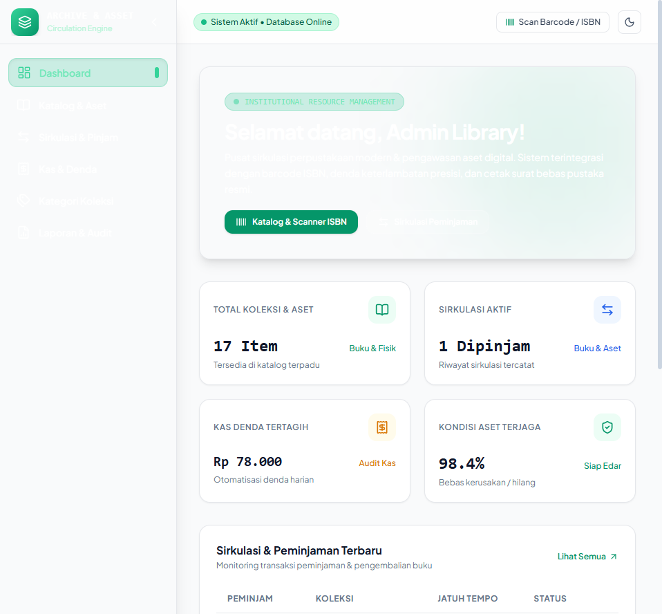

# Library & Asset Management API

Backend REST API untuk mengelola koleksi perpustakaan, aset institusi, peminjaman, pengembalian, denda, anggota, dan laporan. Project dibangun menggunakan Laravel 13, PHP 8.3, Eloquent ORM, dan MySQL atau MariaDB.

Project ini cocok untuk perpustakaan, institusi pendidikan, museum, atau organisasi yang membutuhkan katalog dan alur peminjaman terstruktur.

---

## 📸 Antarmuka Sirkulasi Peminjaman & Tracking Aset Fisik

<p align="center">
  
  <br/>
  <em>Enterprise Dashboard — Arsitektur Sage Forest & Warm Sand dengan Metrik Sirkulasi Real-time</em>
</p>

<p align="center">
  
  <br/>
  <em>Manajemen Transaksi Sirkulasi Peminjaman Buku, Status Jatuh Tempo, dan Denda Otomatis</em>
</p>

<p align="center">
  
  <br/>
  <em>Penerbitan Surat Keterangan Bebas Perpustakaan Resmi dengan Validasi Digital QR & Tanda Tangan</em>
</p>

---

## Fitur

- Register, login, logout, profile, dan reset password
- Autentikasi API menggunakan Laravel Sanctum
- Role-based access untuk Admin, Staff, dan Member
- CRUD kategori koleksi
- CRUD koleksi atau aset dengan katalog publik
- Peminjaman dan pengembalian koleksi
- Perhitungan dan pembayaran denda
- Database transaction untuk menjaga ketersediaan koleksi
- Soft delete dan audit-friendly data management
- Email reminder melalui queue dan scheduler
- Laporan koleksi populer, anggota aktif, dan export laporan
- Dokumentasi kontrak API melalui `openapi.json`
- Frontend asset build menggunakan Vite dan Tailwind CSS

## Tech Stack

| Area | Teknologi |
| --- | --- |
| Language | PHP 8.3+ |
| Framework | Laravel 13 |
| Database | MySQL atau MariaDB |
| ORM | Eloquent |
| API Authentication | Laravel Sanctum |
| Queue | Laravel Queue |
| Scheduler | Laravel Scheduler |
| Frontend assets | Vite dan Tailwind CSS 4 |
| Testing | PHPUnit 12 |
| Code style | Laravel Pint |
| PDF report | barryvdh/laravel-dompdf |

## Prasyarat

- PHP 8.3 atau lebih baru
- Composer
- MySQL 8 atau MariaDB 10.4 atau lebih baru
- Node.js dan npm untuk asset frontend
- PHP extensions: `bcmath`, `ctype`, `fileinfo`, `json`, `mbstring`, `openssl`, `pdo`, `pdo_mysql`, `tokenizer`, dan `xml`

## Instalasi

```bash
git clone git@github.com:Salman-artz/library-asset-management-api.git
cd library-asset-management-api
composer install
copy .env.example .env
php artisan key:generate
```

Edit `.env` sesuai koneksi database:

```env
DB_CONNECTION=mysql
DB_HOST=127.0.0.1
DB_PORT=3306
DB_DATABASE=library_aset_manajemen_db
DB_USERNAME=root
DB_PASSWORD=
```

Jalankan migration dan seeder:

```bash
php artisan migrate --seed
```

Siapkan akses file upload:

```bash
php artisan storage:link
```

Install dan build asset frontend:

```bash
npm install
npm run build
```

## Menjalankan Project

Development server:

```bash
php artisan serve
```

API tersedia di `http://localhost:8000`, dengan base path `/api`.

Untuk development lengkap dengan queue, log, dan Vite:

```bash
composer run dev
```

Jalankan queue dan scheduler secara terpisah bila diperlukan:

```bash
php artisan queue:work
php artisan schedule:work
```

Testing:

```bash
php artisan test
```

Code style:

```bash
vendor/bin/pint
```

## Endpoint Utama

Semua endpoint API menggunakan prefix `/api`.

| Modul | Endpoint |
| --- | --- |
| Auth | `/api/auth/register`, `/api/auth/login`, `/api/auth/logout`, `/api/auth/me` |
| Password | `/api/auth/forgot-password`, `/api/auth/reset-password` |
| Categories | `/api/categories`, `/api/categories/{id}` |
| Collections | `/api/collections`, `/api/collections/{id}` |
| Borrowings | `/api/borrowings`, `/api/borrowings/{id}/return` |
| Fines | `/api/fines/mine`, `/api/fines`, `/api/fines/{id}/pay` |
| Reports | `/api/reports/popular-collections`, `/api/reports/active-members`, `/api/reports/export` |

Endpoint yang dilindungi menggunakan token Sanctum:

```text
Authorization: Bearer <token>
```

## Hak Akses

| Role | Akses utama |
| --- | --- |
| Admin | Akses penuh, termasuk kategori, koleksi, peminjaman, denda, dan laporan |
| Staff | Mengelola koleksi, peminjaman, pengembalian, denda, dan laporan |
| Member | Melihat koleksi, membuat peminjaman, melihat peminjaman dan denda sendiri |

## Struktur Project

```text
app/
  Http/Controllers/Api/   Controller endpoint API
  Models/                 Model Eloquent
  Services/               Business logic aplikasi
  Mail/                   Email reminder
  Console/                Scheduled commands
database/
  migrations/             Struktur tabel database
  seeders/                Data awal aplikasi
routes/
  api.php                 Route REST API
  console.php             Console dan scheduler routes
resources/                View dan frontend assets
public/                   Public files dan hasil build
storage/                  Log dan uploaded files
tests/                    Feature dan unit tests
```

## Akun Demo

Seeder menyediakan akun berikut:

| Role | Email | Password |
| --- | --- | --- |
| Admin | `admin@library.test` | `password` |
| Staff | `staff1@library.test` | `password` |
| Member | `member1@library.test` | `password` |

Ganti password demo sebelum deployment production.

## Dokumentasi API

Kontrak endpoint tersedia pada file [`openapi.json`](openapi.json). Untuk melihat route yang aktif:

```bash
php artisan route:list --path=api
```

## Repository

https://github.com/Salman-artz/library-asset-management-api

## License

MIT
