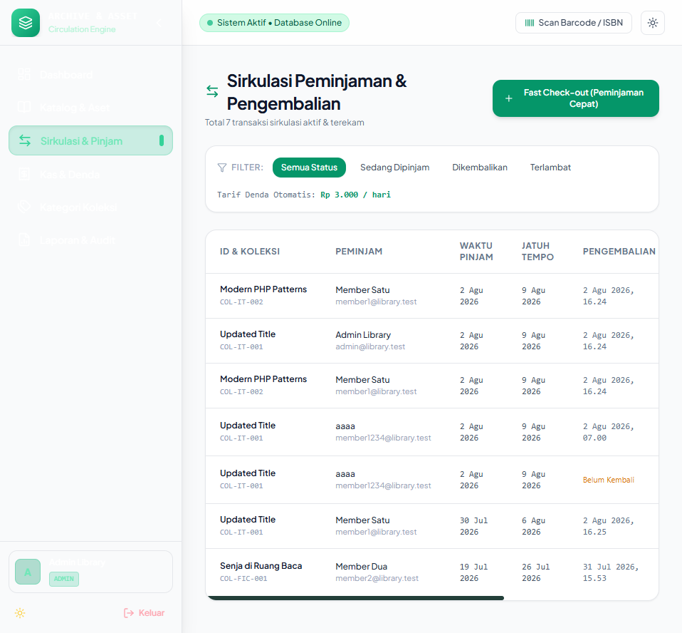
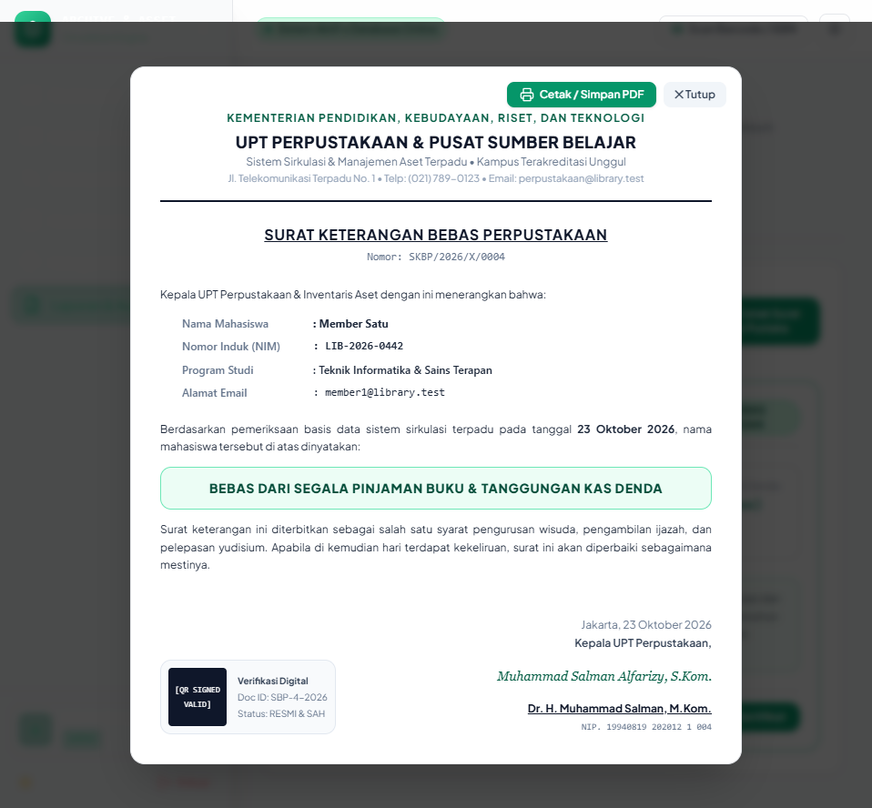

# PUSTAKA SENTRAL — Integrated Library Management REST API (Backend)

Backend REST API untuk sistem informasi perpustakaan institusional terpadu, mengelola koleksi buku & literatur, transaksi sirkulasi peminjaman, pengembalian buku, kalkulasi denda otomatis presisi, analitik sirkulasi buku terpopuler, keanggotaan perpustakaan, dan penerbitan surat bebas pustaka resmi. Dibangun menggunakan Laravel 13, PHP 8.3, Eloquent ORM, dan MySQL/MariaDB.

---

## 📸 Antarmuka Sistem & Sirkulasi Pustaka

<p align="center">
  
  <br/>
  <em>Dashboard Pustaka Sentral — Menampilkan Statistik Sirkulasi, Chart Analitik Buku Terpopuler, dan Aktivitas Meja Sirkulasi</em>
</p>

<p align="center">
  
  <br/>
  <em>Manajemen Transaksi Sirkulasi Peminjaman Buku, Status Jatuh Tempo, dan Denda Otomatis Presisi</em>
</p>

<p align="center">
  
  <br/>
  <em>Penerbitan Surat Keterangan Bebas Perpustakaan Resmi dengan Validasi Digital QR & Tanda Tangan</em>
</p>

---

## 🏛️ Clean Architecture (Repository-Service Pattern)

Arsitektur backend dirancang mengikuti prinsip **Clean Architecture** dan **SOLID (Dependency Inversion Principle)** untuk memastikan pemisahan tanggung jawab (*separation of concerns*), kemudahan pengujian unit (*unit testing*), dan independensi basis data:

```
┌────────────────────────────────────────────────────────┐
│  Presentation Layer (HTTP & API)                      │
│  Controllers, FormRequests, API Resources              │
│  (app/Http/Controllers/Api, app/Http/Requests)        │
└───────────────────────────┬────────────────────────────┘
                            │ (Calls)
                            ▼
┌────────────────────────────────────────────────────────┐
│  Application Layer (Domain Services & Use Cases)       │
│  AuthService, CollectionService, BorrowingService,    │
│  FineService, CategoryService, ReportService           │
│  (app/Services)                                       │
└───────────────────────────┬────────────────────────────┘
                            │ (Depends on Contracts)
                            ▼
┌────────────────────────────────────────────────────────┐
│  Domain Layer (Contracts & Domain Entities)           │
│  Repository Interfaces & Eloquent Models               │
│  (app/Repositories/Contracts, app/Models)             │
└───────────────────────────▲────────────────────────────┘
                            │ (Implements via IoC)
┌───────────────────────────┴────────────────────────────┐
│  Infrastructure Layer (Persistence & Framework)       │
│  Eloquent Implementations, DB Transactions, Sanctum   │
│  (app/Repositories/Eloquent, app/Providers)           │
└────────────────────────────────────────────────────────┘
```

### Struktur Direktori Arsitektural:
- **`app/Http/Controllers/Api/`**: Thin controllers yang hanya menerima request, memvalidasi input via FormRequest, mendelegasikan pemrosesan ke domain service, dan mengembalikan `ApiResponse`.
- **`app/Services/`**: Domain services yang mengisolasi business logic, manajemen transaksi ACID database, formula kalkulasi denda, dan otorisasi data.
- **`app/Repositories/Contracts/`**: Interface kontrak domain (`CollectionRepositoryInterface`, `BorrowingRepositoryInterface`, `FineRepositoryInterface`, `CategoryRepositoryInterface`, `UserRepositoryInterface`).
- **`app/Repositories/Eloquent/`**: Implementasi persistensi Eloquent ORM yang terikat secara otomatis di `AppServiceProvider` melalui Laravel IoC Container.
- **`app/Models/`**: Definisi entitas model domain dan relasi basis data.

---

- **Autentikasi Stateless**: Menggunakan Laravel Sanctum dengan token-based authentication yang aman.
- **Role-Based Access Control (RBAC)**: Pemisahan hak akses berjenjang untuk **Admin**, **Staff**, dan **Member**.
- **Katalog & Koleksi Pustaka**: Pengelolaan koleksi buku lengkap dengan ISBN, barcode, kategori, dan pelacakan stok unit.
- **Transaksi ACID Stok Peminjaman**: Pengurangan dan pengembalian stok koleksi buku dibungkus dalam *Database Transaction* untuk mencegah *race condition* stok minus saat peminjaman simultan.
- **Kalkulasi Denda Keterlambatan Otomatis**: Perhitungan denda harian (Rp 3.000/hari) terotomatisasi secara presisi berdasarkan selisih hari jatuh tempo.
- **Endpoint Analitik Sirkulasi Terpopuler**: Endpoint `/api/reports/popular-collections` yang diagregasikan langsung melalui query database untuk menopang visualisasi horizontal bar chart di frontend.
- **Verifikasi Bebas Pustaka (Graduation Clearance)**: Endpoint validasi tanggungan pinjaman dan tunggakan denda untuk penerbitan surat bebas pustaka.
- **Ekspor Laporan Multi-Format**: Streaming laporan PDF via `barryvdh/laravel-dompdf` dan ekspor data spreadsheet CSV.
- **Dokumentasi Kontrak API**: OpenAPI specification yang terdokumentasi terstruktur melalui file `openapi.json`.

---

## 🛠️ Tech Stack

| Area | Teknologi |
| --- | --- |
| **Bahasa Pemrograman** | PHP 8.3+ |
| **Framework** | Laravel 13 |
| **Database** | MySQL / MariaDB |
| **ORM** | Eloquent ORM |
| **Autentikasi API** | Laravel Sanctum |
| **Antrian (Queue)** | Laravel Queue |
| **Penjadwal (Scheduler)** | Laravel Scheduler |
| **Laporan PDF** | barryvdh/laravel-dompdf |
| **Testing** | PHPUnit 12 |
| **Linter & Code Style** | Laravel Pint |

---

## 📋 Prasyarat

- PHP 8.3 atau lebih baru
- Composer
- MySQL 8 atau MariaDB 10.4 atau lebih baru
- PHP extensions: `bcmath`, `ctype`, `fileinfo`, `json`, `mbstring`, `openssl`, `pdo`, `pdo_mysql`, `tokenizer`, dan `xml`

---

## 🚀 Panduan Instalasi

```bash
# 1. Clone repository
git clone git@github.com:Salman-artz/library-asset-management-api.git
cd library-asset-management-api

# 2. Install dependencies
composer install

# 3. Setup environment
copy .env.example .env
php artisan key:generate
```

Edit file `.env` sesuai konfigurasi database lokal:

```env
DB_CONNECTION=mysql
DB_HOST=127.0.0.1
DB_PORT=3306
DB_DATABASE=library_aset_manajemen_db
DB_USERNAME=root
DB_PASSWORD=
```

Jalankan migrasi database dan seeder:

```bash
php artisan migrate --seed
php artisan storage:link
```

---

## 💻 Menjalankan Server Backend

```bash
# Development server
php artisan serve
```

Server API berjalan di `http://localhost:8000`, dengan endpoint base path `/api`.

Untuk menjalankan worker antrean dan scheduler background:

```bash
php artisan queue:work
php artisan schedule:work
```

Menjalankan automated test:

```bash
php artisan test
```

---

## 📌 Endpoint Utama REST API

Semua endpoint API menggunakan prefix `/api`.

| Modul | Endpoint | Method | Keterangan |
| --- | --- | --- | --- |
| **Auth** | `/api/auth/login` | POST | Login pengguna & penerbitan Bearer token |
| | `/api/auth/register` | POST | Registrasi anggota baru |
| | `/api/auth/me` | GET | Profil pengguna saat ini |
| | `/api/auth/logout` | POST | Pencabutan token sesi |
| **Collections** | `/api/collections` | GET, POST | Katalog koleksi & buku pustaka |
| | `/api/collections/{id}` | GET, PUT, DELETE | Detail & modifikasi koleksi buku |
| **Borrowings** | `/api/borrowings` | GET, POST | Sirkulasi & transaksi peminjaman |
| | `/api/borrowings/{id}/return` | POST | Pengembalian buku & hitung denda |
| **Fines** | `/api/fines` | GET | Audit kas denda keterlambatan |
| | `/api/fines/{id}/pay` | POST | Pembayaran denda & penutupan buku kas |
| **Reports** | `/api/reports/popular-collections` | GET | Data analitik buku paling sering dipinjam |
| | `/api/reports/active-members` | GET | Leaderboard pembaca paling aktif |
| | `/api/reports/export` | GET | Ekspor rekapitulasi data PDF / CSV |

Header untuk endpoint terproteksi:

```text
Authorization: Bearer <token>
```

---

## 🔗 Repository Terkait

- **Frontend Web (React & Vite)**: [Salman-artz/Library-Asset-Management-Frontend](https://github.com/Salman-artz/Library-Asset-Management-Frontend)
- **Backend REST API (Laravel 13)**: [Salman-artz/library-asset-management-api](https://github.com/Salman-artz/library-asset-management-api)

---

## 📄 Lisensi

Proyek ini dilisensikan di bawah lisensi MIT.
